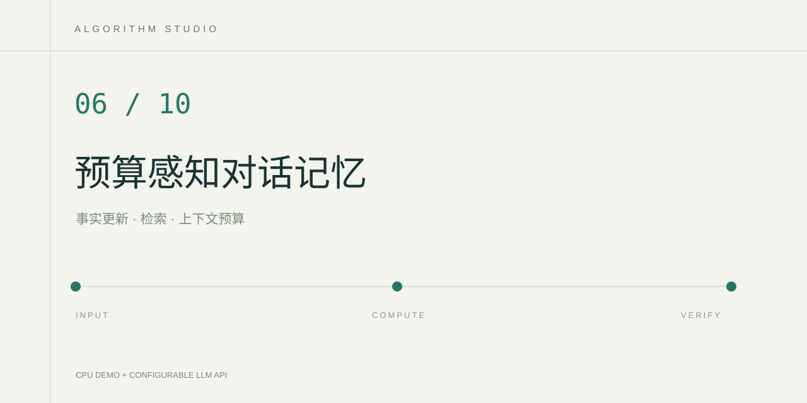

# 预算感知对话记忆

在给定字符预算中，比较“只保留最近消息”与“最新事实加语义检索”的上下文选择。页面会显示保留的原文、字段来源和事实更新记录，便于观察旧目标覆盖和历史信息遗忘。

`data/synthetic_history.json` 是自编的合成学习对话，包含专业、设备条件、职业目标及一次目标更新。程序只读取这份项目数据，不连接个人聊天账号。

## 运行

在 PyCharm 打开项目目录，选择 Python 3.12，安装 `requirements.txt` 中的依赖。右键运行 `app.py`，打开运行窗口中的本地网址。

示例问题为“结合我的专业、设备条件和最新职业目标，给下一阶段学习建议。预算450”。输入里的“预算450”表示最多保留 450 个 Python 字符。可设范围为 160～2000，未指定时使用 450。

本地模式展示实际记忆选择结果和字段提要。API 模式将同一份选中上下文交给云端模型回答当前问题。把 `.env.example` 复制为 `.env`，配置 `LLM_API_KEY`、`LLM_BASE_URL`、`LLM_MODEL` 后即可在页面切换模式。

## 核心算法

- 只从用户明确提供的 `字段=值` 文本抽取事实，同名字段按消息顺序使用最新值。
- 记录旧值、新值和更新来源，排除会重新带入旧事实的原始消息。
- 使用中文字符 TF-IDF 检索当前问题相关的字段和原文。
- 先装入最新事实，再使用余下预算装入相关消息，每个单位计入分隔符，保证最终上下文字符数不超预算。
- 对照组按时间倒序装入最近完整消息，使用相同字符预算。

这个实验明确统计字符，不把字符数宣称为模型 token 数。当前事实抽取依赖显式 `key=value` 格式，对于隐含事实、否定、自然语言修正和复杂时间关系还需要扩展。

## 验证与扩展

运行 `python -m unittest discover -s tests -v`。测试覆盖最新用户事实覆盖、助手无法覆盖用户字段、多个预算边界、旧目标不重新进入上下文、预算校验、完整演示和空输入。

可以把历史分为完整测试案例，每个案例明确应保留事实及应覆盖旧事实，再比较保留率、冲突率、字符成本和答案事实一致性。页面显示的字段数量来自当前合成历史，不能直接解释为所有对话的记忆表现。

## 参考

- TF-IDF 与特征提取。https://scikit-learn.org/stable/modules/feature_extraction.html#text-feature-extraction
- 余弦相似度。https://scikit-learn.org/stable/modules/generated/sklearn.metrics.pairwise.cosine_similarity.html
- Python 字符串与正则表达式。https://docs.python.org/3/library/re.html

历史数据选择、冲突解决和上下文构造均在本地 CPU 上运行。只有页面主动选择 API 模式时才调用远程模型。
